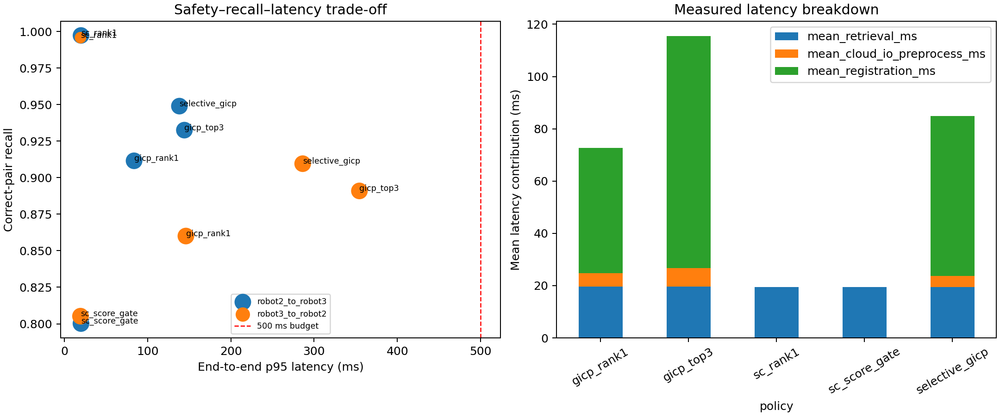

# FYP LiDAR Place Recognition & Registration

CVTNet 迁移实验、Scan Context 候选检索与 GICP 几何验证的项目协作仓库。
维护账号：[woshanli351-afk](https://github.com/woshanli351-afk)。
配套团队仓库：[James-5757/fyp-place-recognition](https://github.com/James-5757/fyp-place-recognition)。

本仓库集中维护 LiDAR/CVTNet/GICP 工作及研究结果；团队仓库保留共享数据处理、检索和 Demo 集成工作。
CU-Multi 依赖模块来自团队代码，具体来源见 [代码来源](docs/PROVENANCE.md)。

## 从这里开始

1. [项目现状与 AI 上下文](PROJECT_CONTEXT.md)
2. [最新 GICP 作用与性价比报告](docs/CUMULTI_STAGE11_GICP_VALUE_STUDY.md)
3. [Robot1/Robot3 数据质量评估](docs/CUMULTI_ROBOT13_DATA_QUALITY_ASSESSMENT.md)
4. [运行指南](docs/RUNNING.md) 与 [候选/配准接口](docs/INTERFACES.md)
5. [下一步](NEXT_STEPS.md) 与 [更新记录](CHANGELOG.md)

## 已有结果

Stage 11 原始实验完成于 2026-09-23，当前发布只整理代码和历史结果，没有重跑完整数据集。
实验报告推荐 **M=1000 Scan Context Rank-1 + 固定 GICP 门槛 0.6091** 作为在线地图拼接的默认候选约束方案。

| Held-out 方向 | Precision | Correct-pair recall | p95 延迟 |
| --- | ---: | ---: | ---: |
| Robot2 → Robot3 | 99.65% | 91.15% | 83.80 ms |
| Robot3 → Robot2 | 99.81% | 86.00% | 146.06 ms |

两方向 GICP 策略在本次离线评价中均未出现预定义 mapping-hazard 事件；仍存在 protocol false positives，
且该结果不代表位姿图或地图融合已经验收成功。SC 直接接受不能提供米制相对变换。
完整定义与限制以报告及原始指标列为准。

KITTI CVTNet 使用公开 NCLT checkpoint 做跨数据集迁移；它没有提升 KITTI Top-1 检索结果。
参见 [CVTNet 历史实验](results/kitti/cvtnet/experiment_summary.md)。



## Progressive mapping demo

`demo/progressive_replay_v2/` combines the frozen Stage 11 accuracy/latency
metrics with the team repository's stable-segment clean batch map snapshots.
It includes direction-switchable accuracy and efficiency panels plus a six-stage
Robot1/Robot3 mapping replay. See the demo README for the local launch command
and its explicit offline claim boundary.

## 目录

```text
src/kitti/              # KITTI SC、CVTNet 适配、几何验证及历史 PGO 实验
src/cumulti/            # 通用 GICP、Stage 11 及其共享依赖
results/kitti/          # 历史指标与图表
results/cumulti_stage11/# Stage 11 汇总、冻结配置、审计与图表
demo/progressive_replay_v2/ # 准确率/效率面板与渐进式地图重放
docs/                  # 报告、接口、运行说明与来源
```

原始点云、GT 数据、权重与完整查询级结果需单独取得；本仓库不附带它们。
`results/` 保存历史证据，新的运行写入被 Git 忽略的 `outputs/`。

## 安装与本地测试

推荐 Python 3.10 或 3.11（完整 GICP 运行还受 Open3D 平台支持限制）。

```bash
python3 -m venv .venv
source .venv/bin/activate
python -m pip install -r requirements.txt
python -m unittest discover -s src/kitti -p test_pipeline.py -v
python -m unittest discover -s src/cumulti -p test_stage11_gicp_value.py -v
python src/cumulti/gicp_value_backend.py --help
python src/cumulti/run_stage11_gicp_value_study.py --help
```

实际配准再安装 `requirements-gicp.txt`；CVTNet 再安装 `requirements-cvtnet.txt` 及官方仓库依赖。
纯逻辑测试不需要点云、权重、CUDA 或 Open3D。

## 同步与协作

每次完成一项工作：更新说明 → 相关测试 → commit → push。
队友读取最新内容前可运行 `git pull --ff-only`，或直接打开本仓库页面。
只做 commit 不会同步至 GitHub。双方 AI 先读 `PROJECT_CONTEXT.md` 和 `NEXT_STEPS.md`，再查看 commit 差异。
公开访问允许读取，写入仍需要仓库权限；AI 读取能力取决于对方启用的工具。
