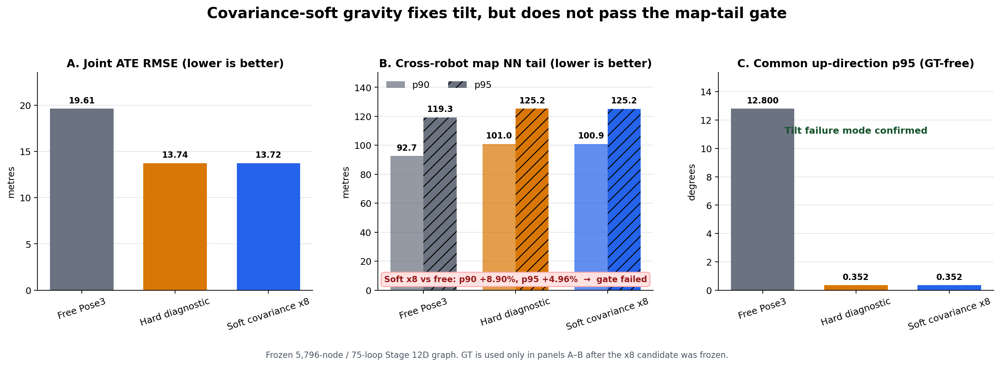
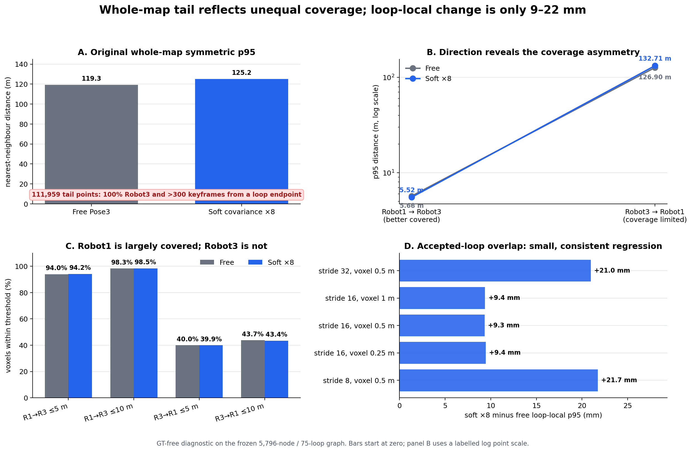
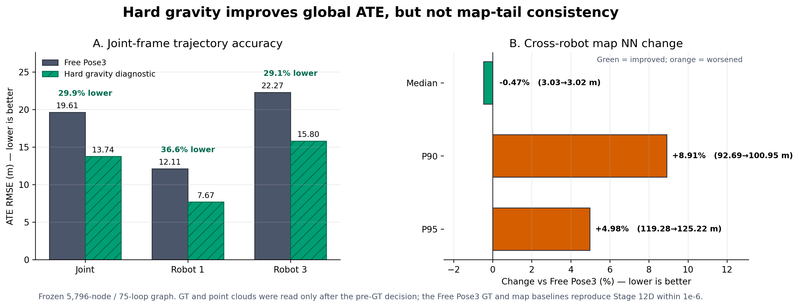
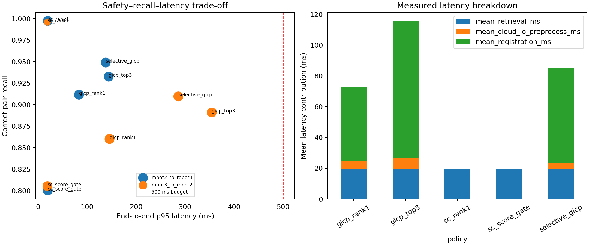

# FYP LiDAR Place Recognition & Registration

CVTNet 迁移实验、Scan Context 候选检索与 GICP 几何验证的项目协作仓库。
维护账号：[woshanli351-afk](https://github.com/woshanli351-afk)。
配套团队仓库：[James-5757/fyp-place-recognition](https://github.com/James-5757/fyp-place-recognition)。

本仓库集中维护 LiDAR/CVTNet/GICP 工作及研究结果；团队仓库保留共享数据处理、检索和 Demo 集成工作。
CU-Multi 依赖模块来自团队代码，具体来源见 [代码来源](docs/PROVENANCE.md)。

## 从这里开始

1. [项目交接文档](docs/HANDOFF.md)
2. [项目现状与 AI 上下文](PROJECT_CONTEXT.md)
3. [最新 GICP 作用与性价比报告](docs/CUMULTI_STAGE11_GICP_VALUE_STUDY.md)
4. [Loop Admission 真实统计审计](docs/CUMULTI_LOOP_ADMISSION_AUDIT.md)
5. [PGO 重力保持诊断](docs/CUMULTI_PGO_GRAVITY_VALIDATION.md)
6. [软重力因子输入审计](docs/CUMULTI_PGO_SOFT_GRAVITY_INPUT_AUDIT.md)
7. [协方差软重力验证](docs/CUMULTI_PGO_SOFT_GRAVITY_VALIDATION.md)
8. [PGO 地图尾部诊断](docs/CUMULTI_PGO_MAP_TAIL_DIAGNOSTIC.md)
9. [PGO 离线精度评价状态](docs/CUMULTI_PGO_OFFLINE_EVALUATION.md)
10. [Robot1/Robot3 数据质量评估](docs/CUMULTI_ROBOT13_DATA_QUALITY_ASSESSMENT.md)
11. [运行指南](docs/RUNNING.md) 与 [候选/配准接口](docs/INTERFACES.md)
12. [下一步](NEXT_STEPS.md) 与 [更新记录](CHANGELOG.md)

## 已有结果

Stage 11 原始实验完成于 2026-09-23，当前发布只整理代码和历史结果，没有重跑完整数据集。
实验报告推荐 **M=1000 Scan Context Rank-1 + 固定 GICP 门槛 0.6091** 作为在线地图拼接的默认候选约束方案。

| Held-out 方向 | Precision | Correct-pair recall | p95 延迟 |
| --- | ---: | ---: | ---: |
| Robot2 → Robot3 | 99.65% | 91.15% | 83.80 ms |
| Robot3 → Robot2 | 99.81% | 86.00% | 146.06 ms |

两方向 GICP 策略在本次离线评价中均未出现预定义 mapping-hazard 事件；仍存在 protocol false positives，
且该结果不代表位姿图或地图融合已经验收成功。SC 直接接受不能提供米制相对变换。
完整定义与限制以报告及原始指标列为准。

2026-11-17 完成 Loop Admission 聚合审计：Robot1→Robot3 的 2,000 个
Rank-1 候选中，1,233 个通过 GICP，时序去重后为 120 个独立事件，再按
Robot1 KF150 / Robot3 KF234 稳定起点过滤为最终 75 条 PGO 边。GICP 通过
与最终接纳现在有独立字段和统计口径；历史 Top-3 的 `1403 -> 139` 是另一条
策略，不能与当前 Rank-1 的 75 条混算。

2026-11-15 完成同一冻结图上的独立 PGO 诊断与离线评价：自由 Pose3 分支
逐节点精确复现团队 Stage 12D；增加 EKF up-vector 硬因子后，公共重力方向
偏差 p95 从 12.800° 降至 0.352°，joint ATE RMSE 从 19.608 m 降至
13.737 m，Robot3 scoped ATE 从 22.271 m 降至 15.798 m。固定间隔 RPE
基本不变，但跨机器人地图 NN p95 从 119.278 m 上升到 125.215 m。因此硬重力
约束仍是诊断上界，不是已经验收的最终后端；后续软因子和尾部来源复核结果见下。

2026-11-16 已补齐 Robot1 原始归档并完成软因子输入与完整实验。Robot1/Robot3
稳定段分别解码 1849/1850、3946/3946 个分轴协方差；唯一缺失的 Robot1
KF1199 超过冻结 header 时间门槛 2.034 ms，按预声明策略省略因子。GT-free
阶段在 `1/2/4/8` 中冻结最弱的 soft ×8。它将 joint ATE RMSE 从 19.608 m
降至 13.725 m。后续 GT-free 尾部诊断确认，原全地图 NN p90/p95 的
8.90%/4.96% 回退主要来自 Robot3 独有、且距闭环端点超过 300 keyframe 的
路线，不能单独作为部分重叠地图的对齐门槛。75 个闭环局部 p95 在五组采样
设置下仍一致增加 9–22 mm，加上当前约 62 s 求解成本，因此 Gravity 继续只
作离线诊断，不进入最终后端或 Demo。







KITTI CVTNet 使用公开 NCLT checkpoint 做跨数据集迁移；它没有提升 KITTI Top-1 检索结果。
参见 [CVTNet 历史实验](results/kitti/cvtnet/experiment_summary.md)。



## Progressive mapping demo

`demo/progressive_replay_v2/` combines the frozen Stage 11 accuracy/latency
metrics with the team repository's stable-segment clean batch map snapshots.
It includes direction-switchable accuracy and efficiency panels plus a six-stage
Robot1/Robot3 mapping replay. See the demo README for the local launch command
and its explicit offline claim boundary.

## 目录

```text
src/kitti/              # KITTI SC、CVTNet 适配、几何验证及历史 PGO 实验
src/cumulti/            # 通用 GICP、Stage 11、PGO 诊断及其共享依赖
results/kitti/          # 历史指标与图表
results/cumulti_stage11/# Stage 11 汇总、冻结配置、审计与图表
results/cumulti_loop_admission/ # Loop Admission 聚合漏斗与来源哈希
results/cumulti_pgo_gravity_validation/ # PGO GT-free 冻结摘要
demo/progressive_replay_v2/ # 准确率/效率面板与渐进式地图重放
docs/                  # 报告、接口、运行说明与来源
```

原始点云、GT 数据、权重与完整查询级结果需单独取得；本仓库不附带它们。
`results/` 保存历史证据，新的运行写入被 Git 忽略的 `outputs/`。

## 安装与本地测试

推荐 Python 3.10 或 3.11（完整 GICP 运行还受 Open3D 平台支持限制）。

```bash
python3 -m venv .venv
source .venv/bin/activate
python -m pip install -r requirements.txt
python -m unittest discover -s src/kitti -p test_pipeline.py -v
python -m unittest discover -s src/cumulti -p test_stage11_gicp_value.py -v
python -m unittest discover -s src/cumulti -p test_loop_admission.py -v
python src/cumulti/gicp_value_backend.py --help
python src/cumulti/run_stage11_gicp_value_study.py --help
```

PGO 重放使用单独的 Python 3.10 环境和 `requirements-pgo.txt`（GTSAM 4.2
需要 NumPy 1.x），测试入口为：

```bash
python -m unittest discover -s src/cumulti -p test_pgo_gravity_validation.py -v
python -m unittest discover -s src/cumulti -p test_pgo_gravity_offline.py -v
python -m unittest discover -s src/cumulti -p test_pgo_orientation_covariance.py -v
python -m unittest discover -s src/cumulti -p test_pgo_soft_gravity_validation.py -v
python -m unittest discover -s src/cumulti -p test_pgo_map_tail.py -v
```

实际配准再安装 `requirements-gicp.txt`；CVTNet 再安装 `requirements-cvtnet.txt` 及官方仓库依赖。
纯逻辑测试不需要点云、权重、CUDA 或 Open3D。

## 同步与协作

每次完成一项工作：更新说明 → 相关测试 → commit → push。
队友读取最新内容前可运行 `git pull --ff-only`，或直接打开本仓库页面。
只做 commit 不会同步至 GitHub。双方 AI 先读 `PROJECT_CONTEXT.md` 和 `NEXT_STEPS.md`，再查看 commit 差异。
公开访问允许读取，写入仍需要仓库权限；AI 读取能力取决于对方启用的工具。
