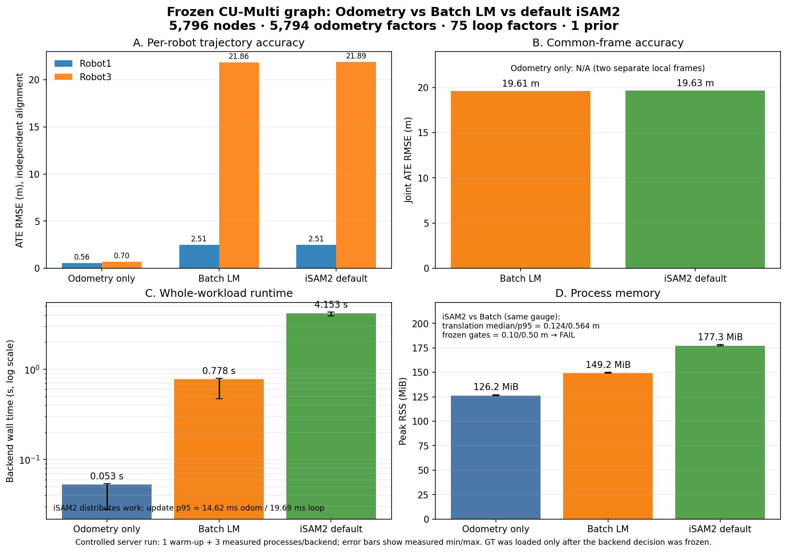

# CU-Multi Odometry / Batch / iSAM2 完整对比

## 结论先行

**最终选择：离线 Demo 继续使用 Batch LM；iSAM2 暂不替换 Batch；odometry-only
只作为每台机器人自身轨迹的基线。**

这个结论不是说 Batch 提高了真实轨迹精度。恰恰相反，在当前 Robot1/Robot3
数据上，每台机器人各自在本地坐标系中的 odometry-only ATE 最低；但它没有
跨机器人约束，不能产生公共坐标系或合并地图。Batch 和 iSAM2 都能利用 75 条
GICP 回环把两台机器人放进同一张图，但离线 GT 结果没有证明这种融合改善了
轨迹精度，Robot3 的独立 ATE 反而明显变差。

iSAM2 的增量更新延迟较低，但默认配置在同一坐标规范下仍未满足冻结的
Batch 数值一致性门槛；而且本次完整回放总工作量和峰值内存都高于 Batch。
因此当前最稳妥的工程选择是：**Batch 用于可复现的离线演示，iSAM2 保留为
增量研究分支，不把现有 Demo 宣称为实时在线系统。**

## 公平比较范围

三种后端使用同一份冻结 Stage 12D 输入：

| 项目 | 数量 |
| --- | ---: |
| 位姿节点 | 5,796 |
| 顺序里程计因子 | 5,794 |
| Rank-1 GICP 跨机器人回环 | 75 |
| 固定先验 | 1 |

- **odometry-only**：只按每台机器人自己的相邻位姿因子累积轨迹。Robot1 和
  Robot3 留在两个独立局部坐标系，所以不能计算有意义的 joint ATE，也不能
  声称已经合图。
- **Batch LM**：一次性加载完整图，使用 GTSAM Levenberg–Marquardt 收敛，
  是当前离线 Demo 的冻结参考。
- **iSAM2 default**：Robot3 作为预加载参考，Robot1 KF150–1999 逐事件回放；
  第一个跨机器人融合事件为 Robot1 KF283 ↔ Robot3 KF252。每个事件调用一次
  默认 Gauss–Newton iSAM2 update，不插入空更新。

三种模式分别以独立进程顺序执行，在同一台 Intel Xeon Gold 6530 服务器上
固定 `OMP_NUM_THREADS=1`、`OPENBLAS_NUM_THREADS=1`、
`MKL_NUM_THREADS=1`。每种模式先 warm-up 一次，再测量三次。三次样本只能给出
受控重复结果，文中的 empirical p95 是描述值，不是稳定的尾延迟估计。

## 准确率对比

### 每台机器人独立对齐

独立 ATE 允许每台机器人分别做刚体对齐，回答“这台机器人的轨迹形状本身有
多准”。它不验证两台机器人之间的公共坐标关系。

| 后端 | Robot1 ATE RMSE | Robot3 ATE RMSE | Combined RPE trans. RMSE | Combined RPE rot. RMSE |
| --- | ---: | ---: | ---: | ---: |
| odometry-only | **0.559 m** | **0.701 m** | 10.549 m | 7.717° |
| Batch LM | 2.510 m | 21.864 m | **10.541 m** | **7.522°** |
| iSAM2 default | 2.513 m | 21.890 m | 10.541 m | 7.522° |

odometry-only 的独立 ATE 最低，说明这组数据中加入跨机器人 GICP 回环并没有
改善各自的真实轨迹形状。Batch/iSAM2 的 Robot3 ATE 大幅升高，说明当前融合图
仍受到跨机器人约束、坐标/传感器语义或数据异常影响。RPE 数值在三种模式间
接近；它是现有固定 10-keyframe 协议的诊断量，不能单独推翻 ATE 结论。

### 公共坐标系联合对齐

| 后端 | Joint ATE RMSE | Joint ATE median | Joint ATE p95 |
| --- | ---: | ---: | ---: |
| odometry-only | N/A | N/A | N/A |
| Batch LM | 19.608 m | 13.652 m | 39.635 m |
| iSAM2 default | 19.632 m | 13.680 m | 39.623 m |

odometry-only 的 N/A 不是漏测，而是它没有估计跨机器人变换。Batch 和 iSAM2
的 joint ATE 几乎相同，但数值较大，所以目前只能说它们产生了公共坐标系，
不能说已经获得高精度合并地图。

## iSAM2 与 Batch 的数值一致性

这里不再分别对齐两条轨迹，而是在同一个 gauge 中逐节点直接比较：

| 指标 | 实测 | 冻结门槛 | 结果 |
| --- | ---: | ---: | --- |
| 平移中位数 | 0.124 m | ≤ 0.100 m | FAIL |
| 平移 p95 | 0.564 m | ≤ 0.500 m | FAIL |
| 旋转中位数 | 0.055° | ≤ 0.500° | PASS |
| 旋转 p95 | 0.302° | ≤ 2.000° | PASS |

默认 iSAM2 精确复现了团队 Stage 13B 的冻结结果（全部指标误差不超过
`1e-6`），但两个平移门槛仍失败。团队 Stage 13C 已测试 V0–V4 五种标准配置，
也没有任何一种通过全部八个 checkpoint。因此“目标函数值接近”和“GT 汇总
指标接近”不能替代逐节点数值一致性验收。

## 效率与资源

| 后端 | Backend wall median | 实测 min–max | Process wall median | Peak RSS median |
| --- | ---: | ---: | ---: | ---: |
| odometry-only | **0.053 s** | 0.028–0.054 s | 0.734 s | **126.2 MiB** |
| Batch LM | 0.778 s | 0.471–0.794 s | 1.691 s | 149.2 MiB |
| iSAM2 default | 4.153 s | 3.895–4.283 s | 5.466 s | 177.3 MiB |

`backend wall` 只覆盖 GT-free 后端构建与计算；`process wall` 还包括输入加载、
轨迹保存和冻结基线检查。它们都不包含 Scan Context、GICP、网络、点云加载和
地图发布，因此不能当作完整系统帧率。

iSAM2 的完整回放总时间更长，但增量工作的重点是把计算分摊到事件上：

- 首次跨机器人融合更新中位数：34.07 ms；
- 普通 odometry update：中位数 0.020 ms，三次运行内部 p95 的中位数 14.62 ms；
- loop update：中位数 0.452 ms，三次运行内部 p95 的中位数 19.69 ms。

这些数字说明 iSAM2 有继续做在线化研究的潜力，但本次是 Robot3 预加载、
Robot1 顺序重放的后端测试，并非两台机器人实时并发运行，也没有覆盖前端和
通信开销。

## 最终系统选择

1. **离线 Demo：保留 Batch LM。** 它是当前唯一已经稳定收敛、逐节点复现且
   能输出公共坐标系的冻结后端。
2. **科研基线：保留 odometry-only。** 它清楚揭示“合图”没有转化为当前数据
   上的精度提升，是后续检查 GICP 约束质量和 Robot3 数据异常的必要对照组。
3. **iSAM2：暂不进入最终 Demo。** 其单事件延迟有优势，但同图平移一致性门槛
   失败，完整回放也没有带来精度或资源优势。
4. **论述边界：** 当前演示可以叫“离线跨机器人地图融合重放”，不能叫“实时
   多机器人 SLAM 已完成”，也不能用合图画面替代 GT 精度验证。

## GT 隔离与可复现性

基准脚本和三种后端运行均不读取 GT。程序先写入 backend 决策和全部结果哈希，
随后才在独立离线评价阶段加载 GT。公开仓库只保存聚合 CSV、协议、哈希与图表；
不保存原始轨迹、逐帧 GT、服务器路径或凭据。

可复现入口：

- GT-free 后端：[benchmark_pgo_backends.py](../src/cumulti/benchmark_pgo_backends.py)
- 冻结后评价：[evaluate_pgo_backend_comparison.py](../src/cumulti/evaluate_pgo_backend_comparison.py)
- 图表生成：[plot_pgo_backend_comparison.py](../src/cumulti/plot_pgo_backend_comparison.py)
- 实验协议：[benchmark_protocol.json](../results/cumulti_pgo_backend_comparison/benchmark_protocol.json)
- 性能汇总：[performance_summary.csv](../results/cumulti_pgo_backend_comparison/performance_summary.csv)
- 离线精度：[offline_accuracy_summary.csv](../results/cumulti_pgo_backend_comparison/offline_accuracy_summary.csv)
- 数值一致性：[numerical_agreement_summary.csv](../results/cumulti_pgo_backend_comparison/numerical_agreement_summary.csv)
- GT 前决策：[pre_gt_decision.json](../results/cumulti_pgo_backend_comparison/pre_gt_decision.json)

求解代码冻结在本仓库提交 `d162a15`。共享输入与 iSAM2 冻结参考来自团队仓库
提交 `c09f9feb002947174d032971d5028487b9a35c85`，其中 Stage 13B/13C 的历史
结论仅作复现参考，没有用 held-out GT 回头调 iSAM2 参数。

## 限制

- 每个后端只有三次正式测量，不能据此宣称稳定生产 p95/p99。
- iSAM2 使用预加载 Robot3 + 重放 Robot1 的固定事件流，不是同步双机器人现场测试。
- 当前对比评价后端，不包含 SC/GICP 前端、点云 I/O、通信或可视化发布。
- 本报告没有改变任何 SC/GICP/PGO 参数，也没有把 GT 用于后端选择。
