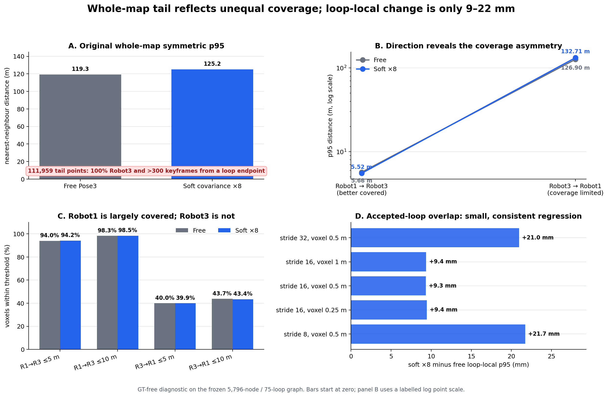

# CU-Multi PGO 地图尾部诊断

日期：2026-11-17。状态：GT-free 定位、方向分解、75 个闭环局部复核和五组采样
敏感性检查已完成。

## 为什么要重新检查

此前同一 5796 节点/75 回环图的全地图双向最近邻（NN）结果显示，soft ×8
相对自由 Pose3 的 p90/p95 分别上升 8.90%/4.96%。这个指标把两台机器人各自
走过的所有地图点放在一起；如果两条路线覆盖范围不同，某台机器人独有的区域
即使本来就没有对应点，也会形成很大的最近邻距离。

因此本轮不调整任何 GICP、PGO 或 Gravity 参数，而是回答两个更窄的问题：

1. 100–125 m 的尾部点来自哪个机器人、哪些关键帧和闭环覆盖范围；
2. 在真正被 75 条已接受闭环连接的局部重叠区域，soft ×8 是否仍然变差。

## 协议与数据边界

- 使用已经冻结的自由 Pose3、soft ×8 轨迹和 75 条回环，不重新求解；
- 全地图复现保持 frame stride 10、point stride 16、1–60 m 距离过滤和
  0.5 m voxel；
- processed keyframe 表只读取 `keyframe_id` 与 `lidar_file`，不读取 GT 位姿；
- 逐方向计算 Robot1→Robot3 与 Robot3→Robot1 最近邻；
- 对每条已接受回环，将两个端点扫描按相应轨迹变换到公共坐标系，再计算局部
  双向 NN；
- 用 point stride 8/16/32 和 voxel 0.25/0.5/1.0 m 共五组设置检查结论稳定性；
- 完整逐帧和逐回环明细只留在外部实验目录，Git 只保存聚合结果和哈希。

全部步骤不使用 GT；`map_tail_diagnostic_summary.json` 明确记录 `GT_used=false`。

## 主要发现

### 1. 原全地图指标被精确复现

| 全地图双向 NN | 自由 Pose3 | soft ×8 |
| --- | ---: | ---: |
| median | 3.031 m | 3.018 m |
| p90 | 92.693 m | 100.945 m |
| p95 | 119.278 m | 125.198 m |

所以异常不是旧评价器的偶然误差。

### 2. 分方向后，覆盖不对称非常明显

| 方向 | 方案 | p95 | 5 m 内点比例 | 解释 |
| --- | --- | ---: | ---: | --- |
| Robot1→Robot3 | free | 5.682 m | 93.98% | Robot1 基本被 Robot3 路线覆盖 |
| Robot1→Robot3 | soft ×8 | **5.521 m** | **94.23%** | p95 改善 2.84% |
| Robot3→Robot1 | free | 126.900 m | 39.96% | Robot3 有大量 Robot1 未经过的区域 |
| Robot3→Robot1 | soft ×8 | 132.708 m | 39.92% | 该方向由无对应覆盖主导 |

全地图尾部不能被解释为“两幅重叠地图整体错开”：在覆盖较好的 Robot1→Robot3
方向，soft ×8 的 median、p90 和 p95 反而都略有改善。

### 3. 所有极端尾部点都来自无闭环覆盖的 Robot3 长路段

以自由基线全地图 p90 `92.6928 m` 为固定阈值，soft ×8 中有 111,959 个点
超过该值：

- 100% 来自 Robot3；
- 100% 距最近闭环端点超过 300 个关键帧；
- Robot3 的闭环端点在 KF252 与 KF2481 之间存在 2229 keyframe 的大空档；
- 尾部点中 33.25% 来自 KF0–999，66.75% 来自 KF1000–1999，KF2000 以后为 0。

这说明原 p90/p95 主要度量“Robot3 独有路线离 Robot1 路线有多远”，而不是
跨机器人真实重叠区域的配准质量。

### 4. 闭环局部只有毫米级、但方向一致的回退

基准设置 point stride 16、voxel 0.5 m 下，75 个已接受闭环端点扫描的 pooled
p95 从 2.6038 m 上升到 2.6131 m，即 **+9.3 mm（+0.36%）**；35 条闭环改善，
40 条变差。五组采样设置的 p95 差值全部为正，范围为 **+9.3 至 +21.7 mm**
（+0.30% 至 +1.16%）。

回环残差变化也很小：平移残差增量 p95 为 10.4 mm，旋转残差增量 p95 为
0.868°。没有证据支持“Gravity 造成灾难性的重叠地图错位”，但在冻结的严格
不恶化规则下，也不能把小幅一致回退忽略掉。

## 修正后的结论

原来的“全地图尾部恶化 5%–9%”是真实可复现的数值，但**不能作为部分重叠、
覆盖不相等路线的独立地图对齐门槛**。它把覆盖差异与配准误差混在了一起，
明显夸大了重叠区域的变化。

系统选择暂时不变：soft Gravity 仍只作离线诊断，不进入最终后端或 Demo。
理由修正为：

1. 75 个闭环局部 p95 在五组设置下仍一致增加 9–22 mm，没有通过预先冻结的
   “地图不得恶化”规则；
2. 当前 Python `CustomFactor` 完整求解约 62 s，不满足在线使用；
3. 不能根据本轮结果再用 held-out GT 或地图指标回调 Gravity 权重。

后续地图评价应同时报告方向覆盖率、闭环局部指标和全地图指标；全地图双向
NN p90/p95 只作为覆盖敏感的描述量，不能单独决定地图是否验收。

## 公开结果与复现

- `map_tail_diagnostic_summary.json`：协议、哈希、归因和最终判定；
- `map_tail_directional_metrics.csv`：双方向完整分位数和覆盖率；
- `map_tail_loop_local_sensitivity.csv`：五组闭环局部敏感性结果；
- `map_tail_diagnostic.png`：论文/组会可用汇总图。

运行命令见 [RUNNING.md](RUNNING.md)。原始点云、逐帧/逐回环明细、服务器路径
和凭据不进入 Git。
