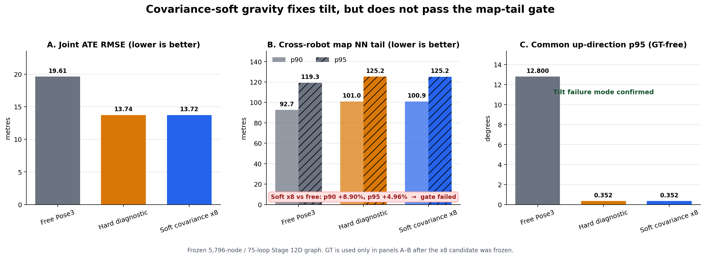

# CU-Multi 协方差软重力验证

日期：2026-11-16。状态：完整 pre-GT 选择和冻结后离线 GT/点云评价已完成；
**软重力因子未通过地图尾部采用门槛，不进入最终后端或 Demo。**

## 研究问题

硬重力诊断已经证明自由 6DoF PGO 会破坏 EKF 重力方向，并把 joint ATE RMSE
从 19.608 m 降到 13.737 m；但它同时使跨机器人地图 NN p90/p95 恶化。这里
检验更具体的假设：**使用原始 EKF roll/pitch 协方差进行按节点软约束，能否
保留 ATE 改善，同时消除地图尾部回退。**

实验保持同一 5796 节点、5794 顺序边、75 条 Rank-1 GICP 回环和 Stage 12D
初始化。没有重新选择起点、回环、GICP 门槛或位姿图噪声。

## 严格的 GT 隔离

实验分成两个不可逆阶段：

1. **pre-GT 阶段**只读取局部轨迹、回环边和原始 EKF 分轴协方差；
2. 预声明协方差膨胀尺度 `1, 2, 4, 8`，基础 sigma 为
   `sqrt((roll_var + pitch_var)/2)`；
3. 每个尺度只检查公共 up p95、回环平移残差和相邻大步长；
4. 在所有通过 GT-free 门槛的方案中冻结最大尺度，即最弱约束；
5. 只有被冻结的候选才进入独立离线 GT/地图评价，评价器不重新运行求解器。

Robot1 KF1199 因 header 时间差 52.034 ms 超出冻结的 50 ms 门槛而不加因子；
其余 5795 个节点都有协方差，其中锚点不需要重力因子，最终加入 5794 个因子。

## pre-GT 结果与选择

采用门槛固定为：公共 up p95 不超过 2°；回环平移 p95 相对自由基线上升不
超过 20%；不新增相邻 >5 m 步长。

| 方案 | 公共 up p95 | 回环平移 p95 | 新增 >5 m | 求解时间 |
| --- | ---: | ---: | ---: | ---: |
| 自由 Pose3 | 12.7996° | 0.19620 m | 0 | 0.35 s |
| soft ×1 | 0.35237° | 0.19402 m | 0 | 56.08 s |
| soft ×2 | 0.35237° | 0.19402 m | 0 | 57.53 s |
| soft ×4 | 0.35238° | 0.19402 m | 0 | 60.58 s |
| **soft ×8** | **0.35240°** | **0.19402 m** | **0** | 61.85 s |

四个尺度全部通过，所以按预声明规则在读取 GT 前冻结最弱的 `soft ×8`。冻结
轨迹 SHA-256 为
`b8347792a86eb3fdbd478f3c7c42a1b0f572a6d964b70db4f6294328fa003d6b`。
这里的 Python `CustomFactor` 运行约 62 s，只适合离线诊断；即使精度门槛通过，
进入在线系统前也需要原生因子实现和重新测时。

## 冻结后的离线结果

自由基线的 GT 与地图指标均在 `1e-6` 容差内复现上游结果；pre-GT 决定未变，
离线评价没有重跑求解器。

| 指标 | 自由 Pose3 | 硬重力诊断 | soft ×8 | soft 相对自由 |
| --- | ---: | ---: | ---: | ---: |
| joint ATE RMSE | 19.608 m | 13.737 m | **13.725 m** | **-30.00%** |
| Robot1 scoped ATE RMSE | 12.108 m | 7.674 m | **7.663 m** | **-36.72%** |
| Robot3 scoped ATE RMSE | 22.271 m | 15.798 m | **15.785 m** | **-29.12%** |
| combined RPE translation RMSE | **10.5409 m** | 10.5411 m | 10.5411 m | +0.002% |
| combined RPE rotation RMSE | 7.522° | **7.496°** | 7.496° | -0.34% |

| 跨机器人地图 NN | 自由 Pose3 | 硬重力诊断 | soft ×8 | soft 相对自由 |
| --- | ---: | ---: | ---: | ---: |
| median | 3.031 m | **3.016 m** | 3.018 m | -0.40% |
| p90 | **92.693 m** | 100.950 m | 100.945 m | **+8.90%** |
| p95 | **119.278 m** | 125.215 m | 125.198 m | **+4.96%** |

soft ×8 的 ATE 略优于硬诊断，但差异小于 0.15%；地图 p90/p95 也几乎与硬
诊断相同。它证明按 EKF 协方差建模并没有消除尾部回退，因而“硬约束过强”
不能单独解释当前问题。

## 最终判定

采用门槛要求 joint/Robot3 ATE 改善、RPE 不实质恶化、地图 NN p90/p95 均不
恶化。soft ×8 前三项通过，最后两项失败。因此：

- **不把 hard 或 soft Gravity 合入最终地图后端；**
- **不把 Gravity 结果替换进现有渐进式 Demo；**
- 保留它们作为论文中的失效模式诊断：自由 Pose3 的 roll/pitch 确实会漂移；
- 下一步不再继续用 held-out GT 调 Gravity 尺度，而是定位造成地图尾部冲突的
  少量回环/区域，包括回环旋转与 EKF up 的冲突、公共坐标系初始化，以及
  p90/p95 对应的具体帧和空间位置。

这不是“Gravity 没用”：它显著改善 ATE，并确认了倾斜问题；但按照地图拼接的
安全门槛，它还不是可部署修复。

## 公开结果与复现

公开仓库保存：

- `soft_covariance_input_summary.json`：协方差覆盖率和分位数；
- `soft_covariance_pre_gt_decision.json`：无 GT 的尺度选择；
- `soft_covariance_selected_summary.json`：所选分支的因子、残差和求解摘要；
- `soft_covariance_offline_gt_metrics.csv` 与
  `soft_covariance_map_consistency.csv`：冻结后离线评价；
- `soft_covariance_validation_status.json`：最终采用门槛和结论。

运行命令见 [RUNNING.md](RUNNING.md)。原始 ROS 包、GT、点云、逐节点协方差、
完整轨迹、服务器绝对路径和凭据均不进入 Git。
