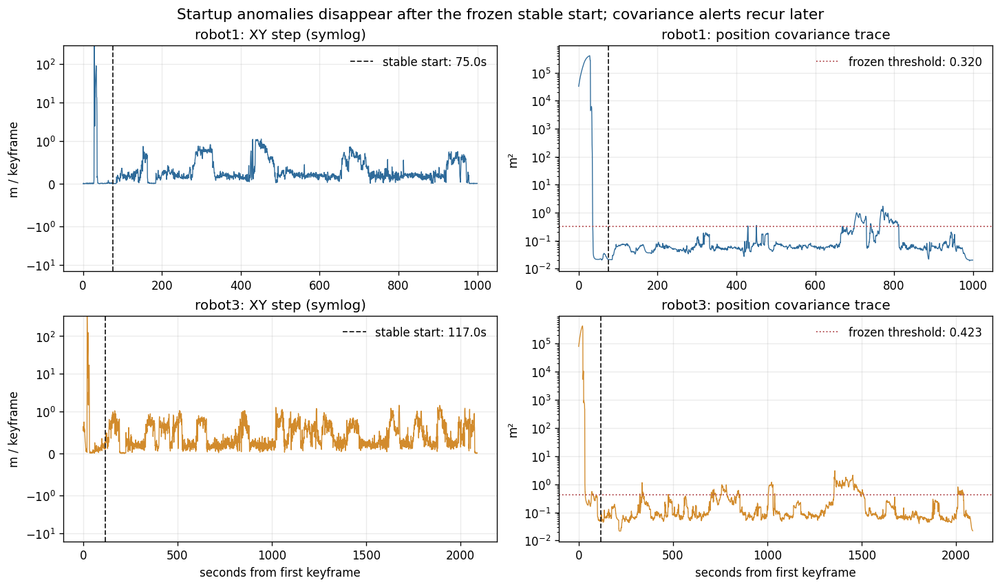

# CU-Multi Robot1 / Robot3 data-quality assessment

Updated: 2026-10-13.

## Scope and evidence

This assessment separates source-data quality from Scan Context/GICP accuracy,
pose-graph behaviour, and presentation rendering. It reviews the frozen 2 Hz
Robot1/Robot3 keyframe audit, the raw IMU/GNSS EKF forensic outputs, the clean
backend evaluation, and the later solver/measurement diagnostics.

The two full-run audit tables contain one row per LiDAR keyframe:

| Robot | Keyframes | Duration | Keyframe-ID duplicates | Timestamp duplicates | Timestamp order |
| --- | ---: | ---: | ---: | ---: | --- |
| Robot1 | 2,000 | 999.535 s | 0 | 0 | strictly increasing |
| Robot3 | 4,180 | 2,089.511 s | 0 | 0 | strictly increasing |

The local copies match the current server files exactly:

- Robot1 SHA-256: `f9de42c93035ce590320a164fc1014322b2847b01417b8291cdf1174a6d9a34c`
- Robot3 SHA-256: `401ec248a859618269a636d390133b0621c4baa7d34cd9bccd12d4ffc85b35a1`

The original Stage 12C audit was based on team commit `49a53e8`. The team
repository is now at `bf30e1a`; no file under the Stage 12A--12C data audit,
its source readers, or its reports changed between those commits. Later
Stages 14--18 investigated graph numerics, loop information, and presentation,
not a replacement Robot1/Robot3 source trajectory.

## Findings

### Critical: the full-run EKF trajectories are not valid odometry inputs

Robot1 has 13 adjacent XY steps above 5 m, concentrated at KF57--59 and
KF61--70 (28.53--35.04 s from its first keyframe). Its largest 2 Hz step is
291.454 m. Robot3 has 19 such steps at KF43--55 and KF61--66
(21.55--33.00 s), with a 333.575 m maximum.

The raw approximately 100 Hz EKF confirms that these are multi-second estimator
excursions rather than CSV sampling errors or one corrupted record. At the two
largest transitions, about 60 high-rate messages span the keyframe interval and
the largest individual EKF increments are 7.068 m and 7.636 m. Pose-implied
speeds are about 594 and 689 m/s, while reported endpoint twist is below
0.18 m/s.

Both raw GNSS antennas remain nearly stationary in the same intervals. The
offline GT diagnostic, performed after the stable-start policy was frozen,
shows only 0.0035 m and 0.0055 m XY movement. EKF map and earth outputs share
the excursion, covariance is already extremely large, frame IDs do not change,
and timestamps do not regress.

The supported root-cause family is early EKF state initialization/convergence
failure, with medium confidence. A discrete reset trigger is not proven because
the IMU/GPS archives contain no TF and the recorded MicroStrain status payload
does not match the available message definition closely enough for safe decode.
Dropping one or two individual poses would not repair a multi-second excursion.

### High: stable-segment heading semantics remain unresolved

After excluding startup, EKF yaw is still not consistently explained by motion
direction using one fixed offset or sign convention. In a time-blocked 2 s
motion comparison, median EKF-heading versus course residual is 33.21 degrees
for Robot1 and 25.27 degrees for Robot3; p95 remains large. On the small set of
moving loop endpoints, GICP relative yaw is substantially closer to course
difference than to EKF relative yaw, but the test loops are temporally clustered
and course is not an independent heading ground truth.

This is evidence of a material pose/orientation convention or estimator issue,
not proof that every GICP rotation is correct or that every EKF yaw is wrong.
It matters to pose-graph optimization because mutually inconsistent yaw
constraints can deform a long trajectory even when roll/pitch and the up axis
are consistent.

### Medium: isolated covariance excursions recur after the frozen starts

The GT-free stable-start policy selects Robot1 KF150 (75.034 s) and Robot3
KF234 (117.003 s). It retains 1,850/2,000 (92.5%) and 3,946/4,180 (94.4%)
keyframes. The common stable recording interval is 873.572 s and contains
1,748 keyframes from each robot.

After those starts there is no major recurrence in translation, implied speed,
rotation, or EKF-versus-GNSS step disagreement. Maximum XY steps are 1.128 m
and 1.470 m. However, the frozen `5 x` covariance rule flags Robot1 KF1543 once
(trace 1.690 m2) and Robot3 KF2715--2717 three times (up to 3.039 m2). The
simultaneous XY steps are only 0.066--0.268 m, so these are health warnings,
not repeated position jumps.

The stable suffix is therefore suitable for the frozen offline clean-backend
study with health flags, but it did not pass the stricter all-signal
no-major-recurrence certification needed for an unconditional live claim.

### Low: a few audit associations fall outside the nearest-message window

Robot1 has one EKF association 52.0 ms from its keyframe timestamp and four
IMU associations outside the fixed window. Robot3 has two IMU associations
outside the window. Both GNSS streams match every keyframe. All 5,796 clean
trajectory poses are finite and have unique graph keys, so these are audit
coverage gaps rather than missing graph nodes.

Robot3 GNSS2 reuses the same nearest raw message at 286 adjacent keyframes.
This follows the relative source/keyframe rates; the audit deliberately leaves
the derived step empty when no new raw sample exists instead of recording false
zero motion. It is not a 286-row sensor dropout.

## Issues ruled out

- The ZIP CRC, extracted SQLite integrity checks, metadata message counts, and
  required Robot1/Robot3 LiDAR, IMU/GPS, RGB, pose, UTM, and calibration inputs
  pass for the current pipeline.
- Robot3 depth/label archives and most Robot4 sensors are absent locally, but
  they are not inputs to the Robot1/Robot3 LiDAR mapping study.
- `/tf` is expected in the separate reference-pose bag, not in the IMU/GPS ZIP.
  Its absence from the latter is not evidence of a failed download.
- Keyframe IDs and timestamps are unique and ordered. The catastrophic startup
  motion is already present in the raw EKF stream; GTSAM and the browser did not
  create it. The old stride-10 browser view made it more visually dramatic.

## Impact on the current system

- Scan Context and GICP use LiDAR geometry and are not directly invalidated by
  the EKF startup failure.
- Any pose graph that includes the startup odometry factors has compromised
  physical interpretation, even if its numerical optimizer converges.
- The clean75 presentation correctly uses Robot1 KF150--1999 and Robot3
  KF234--4179. That removes the catastrophic startup transitions but does not
  prove the merged map is globally accurate.
- With all 75 clean loops, sampled map nearest-neighbour median improves from
  10.865 m to 3.031 m, while offline joint ATE worsens from 16.966 m to
  19.608 m. Robot1 ATE improves and Robot3 ATE worsens, showing that graph
  correction redistributes error. This is not a remaining raw-data jump.
- Later Stage 13--17 failures concern incremental/batch numerical agreement,
  weak/nonuniform loop support, and residual geometry. They are separate from
  the source EKF startup defect and do not justify restoring excluded poses.

## Operational decision

1. Do not use the full Robot1/Robot3 EKF trajectories for map fusion.
2. Keep the frozen starts at Robot1 KF150 and Robot3 KF234 for the current
   offline Demo and batch study.
3. Preserve covariance, source-match, and heading-consistency fields as health
   telemetry. Do not silently interpolate the startup excursion or relax the
   frozen covariance rule.
4. Continue to describe the Demo as an offline replay based on precomputed clean
   segments. The data evidence does not support a live or production-ready claim.

## Smallest useful next investigation

Recover the recording-time MicroStrain message definitions and the actual
launch configuration/map-earth TF. Decode `ekf/status`, dual-antenna heading
status, filter state, and fix state around Robot1 KF56--70 and Robot3 KF42--66,
then compare the four late covariance-alert frames. Separately validate yaw on
a small set of high-conflict loops using raw point-cloud overlays and an
independent heading reference before changing graph weights or EKF orientation.

Stable automated checks should enforce unique keyframe IDs, monotonic
timestamps, declared crop boundaries, finite poses, no post-crop step above
5 m, complete loop endpoints, and explicit logging of covariance/source-match
alerts.
